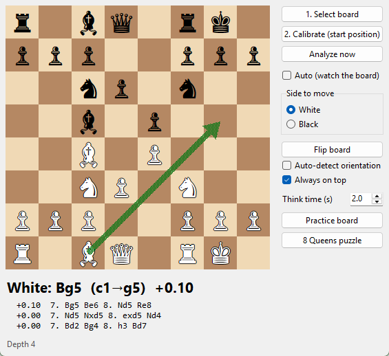
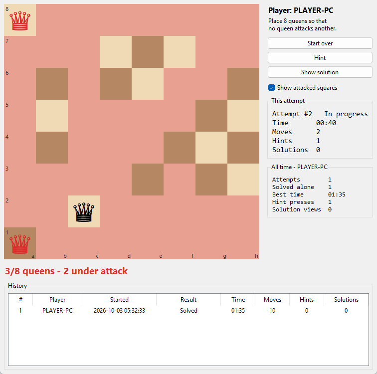

# Chess Vision

**Reads a chessboard from your screen and shows the best move.** It comes with a built-in chess engine, a practice board with adjustable hints, and the Eight Queens puzzle with saved records.

Windows app written in Python. It needs no Stockfish and no internet connection.

[**⬇ Download the installer**](https://github.com/mPhpMaster/chess-vision/releases/latest) · [عربي](#بالعربي)



## Features

### Board reader
- Works with any chess site or app, and with any board colours or piece set. You calibrate it once from the starting position.
- Copes with highlighted squares (last move, selection) and with flipped boards. It detects which side is at the bottom on its own.
- Works out whose turn it is when it sees a single move played.
- Shows the best move as a green arrow, plus the top 3 lines with evaluations. In **Auto** mode it updates live as the game goes on.

### Built-in engine (`engine.py`)
Pure Python, about 400 lines. It uses alpha-beta search with iterative deepening, a transposition table, null-move pruning, late move reductions and quiescence search. It evaluates positions with a tapered evaluation that includes passed pawns and a mop-up term for won endgames. **Think time** controls how strong it plays.

### Practice board
Move the pieces yourself for both sides and get a hint for every move. The **error rate** slider sets how often a hint is a weaker move instead of the best one. The rate also shortens the engine's thinking time.


### Eight Queens puzzle
Place 8 queens so that no queen attacks another. There are 92 solutions.
- **Hint** adds one correct queen. **Show solution** steps through all 92 solutions.
- Every attempt is timed and its moves, hints and solution views are counted. The record is saved per player, using the computer's name.
- A history table and all-time stats (including best time) are shown in the window.



## Install

Download `ChessVision-Setup-x.y.z.exe` from [Releases](https://github.com/mPhpMaster/chess-vision/releases/latest) and run it. You can install it for yourself only (no admin rights needed) or for all users, and choose any folder or drive. The installer adds Start menu shortcuts for **Chess Vision**, **Eight Queens** and **Practice board**.

A portable zip is also attached to each release. Unzip it anywhere and run `ChessVision.exe`.

> The installer is not code-signed. If Windows shows "Windows protected your PC", click **More info → Run anyway**.

## How to use the board reader
1. **Select board**: your screen freezes. Drag a square around the 8×8 squares. Fine-tune with the arrow keys (move) and Shift+arrow keys (resize) until the green grid matches the squares, then press Enter.
2. **Calibrate**: show the board in the **starting position** and click Calibrate.
3. Tick **Auto**, or click **Analyze now**.

If you move or resize the window the board is in, select the board again. If you change the piece set, calibrate again.

Saved data (calibration and puzzle records) lives in `%APPDATA%\ChessVision`. Uninstalling keeps it.

## Run from source
```bash
pip install -r requirements.txt
python chess_vision.py              # main window
python chess_vision.py --queens     # Eight Queens only
python chess_vision.py --practice   # Practice board only
python test_recognition.py          # board-recognition self test
```

## Build the EXE and installer
Requires [PyInstaller](https://pyinstaller.org) (`pip install pyinstaller`) and [Inno Setup 6](https://jrsoftware.org/isdl.php).
```bash
powershell -ExecutionPolicy Bypass -File installer\build.ps1
```
The output is written to `build\dist\ChessVision\` (the app) and `build\installer\` (the setup file).

## Project layout
| File | What it does |
|---|---|
| `chess_vision.py` | Main window: screen capture, board recognition, analysis display |
| `engine.py` | The chess engine |
| `practice.py` | Practice board with error-rate hints |
| `queens.py` | Eight Queens puzzle and its saved records |
| `appdata.py` | App name and version, and where saved files live |
| `installer/` | Icon generator, Inno Setup script, build script |

## Fair play
Using an engine during rated games breaks the rules of chess.com, lichess and other sites. They detect it, and it can get your account banned. Use Chess Vision for analysis, studying your own games, puzzles and games against bots.

## License
[MIT](LICENSE)

---

## بالعربي

**Chess Vision** برنامج ويندوز يقرأ رقعة الشطرنج من شاشتك ويقولك أفضل نقلة. يشتغل بمحرّك شطرنج خاص فيه، بدون Stockfish وبدون إنترنت.

**المميزات:**
- **قراءة الرقعة:** يشتغل مع أي موقع أو برنامج شطرنج، وبأي ألوان رقعة وأي شكل أحجار. يكفي تعايره مرة وحدة من وضعية البداية.
- **أفضل نقلة:** يعرضها بسهم أخضر، ومعها أفضل 3 نقلات بتقييمها. ولو فعّلت **Auto** يتابع اللعبة مباشرة.
- **لوح التدريب:** تحرّك الأحجار بنفسك للطرفين، والبرنامج يقترح عليك النقلة بنسبة خطأ تختارها.
- **لغز الوزراء الثمانية:** فيه تلميح، وعرض للحلول الـ 92. يحسب لكل محاولة الوقت والخطوات وعدد ضغطات التلميح والحل، ويحفظها باسم الجهاز.

**التثبيت:** نزّل ملف التثبيت من صفحة [Releases](https://github.com/mPhpMaster/chess-vision/releases/latest) وشغّله. تقدر تختار القرص والمجلد اللي تبغاه. ولو طلع لك تحذير ويندوز، اضغط **More info** ثم **Run anyway**.

**تنبيه:** استخدام المحرّك أثناء المباريات المصنّفة يخالف قوانين مواقع الشطرنج، وممكن ينحظر حسابك بسببه. استخدمه للتحليل والتدريب والألغاز.
